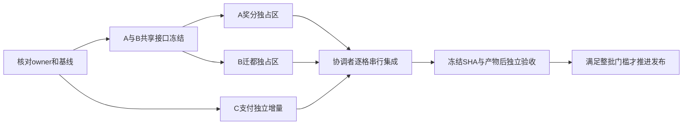

# 多任务协同入口（2026-10-31）

目标：把当前已明确的工作分成可单独领取、验证和交接的任务包，避免同文件、生成物、数据库和运行实例发生并发写入。源码范围以基线 `5fbf4e4c8f3a74db596206292e1c2ae2dd52f81a` 为准；当前只是分工文档，**没有启动 A/B/C/Q 或转移旧源码写入权**。

总状态沿用 [开发包 §零](../../待完善收口_VibeCoding开发包.md#current-execution)，原始产品规格仍在 Bxx。这里保存分工和交接规则；实际 owner、进度、资源和下一步只由协调者写入既有 `.qoder-work-queue.md`。本文件与 [ownership.json](./ownership.json) 是声明，不是自动锁；路径无冲突也不等于业务语义无冲突。

## 1. 直接分派表

| 槽位 | 任务包 | 可同时做什么 | 必须等待什么 |
|---|---|---|---|
| COORD 协调者 | 本文 + ownership.json | 分配文件/接口、审核变更请求、接收证据、逐格合入 | 共享写入必须串行；原owner未明确释放时不接管 |
| A 奖分 | [A-war-awards.md](./A-war-awards.md) | 两条奖分RED、历史区间读取、持久计划、确定性分摊与幂等落榜 | R0冻结国家历史接口、锁顺序与保存语义；共享接线由COORD完成 |
| B 迁都 | [B-capital-migration.md](./B-capital-migration.md) | 撤防/返城判据、迁都专用服务及拒绝分支测试 | R0冻结迁都契约与国家聚合接线；生成物由COORD交付 |
| C 支付 | [C-gameitem-production.md](./C-gameitem-production.md) | prod拒绝旧回调、dev/test兼容、GameItem readiness回归 | 确认当前文件归属和本线环境；不依赖A/B功能完成 |
| Q 验收 | [Q-integration-acceptance.md](./Q-integration-acceptance.md) | 提前准备矩阵和只读复审；在冻结候选上独立验收 | 运行验收等待候选SHA、产物与资源窗口；不修改受验实现 |

推荐人员安排是 **1名协调者 + A/B/C三条工作线**；Q是独立验收角色，不要求第五个常驻任务。可用槽位不足时，在工作线交接后安排未实现该候选的审查者担任Q，保留实现者与验收者区分。复用已有聊天/代理，不因读到本文件自动创建用户聊天。

## 2. 开工前的 R0（短而必须完成）

- [ ] COORD 核对主树/候选SHA、dirty与暂存区、原B13及支付文件owner。旧队列中的“active”和旧线程ID只作线索；没有释放或当前归属证据时，相关线只能只读准备，其他已明确归属的线可继续。
- [ ] A/B 提交最小共享接口提案。A复用已有两层成员历史；B复用合法撤防返城链。COORD 确定接口/字段/错误边界和锁顺序，按需要实现最小共享前置，单独验证、落档、提交。
- [ ] 用真实提交SHA发布接口基线，A/B按该基线开始依赖代码；接口尚未冻结时只能做已有接口范围内的反证、案例和设计，不能各自假定签名后并行接线。C只需本线归属确认即可开始。
- [ ] COORD 为每线登记真实 `thread_id / worktree / branch / base_sha / allowed_paths / changed_interface / resource_owner / next_step / evidence`。未运行标 `NOT_STARTED`，前提不足标 `PREREQ`；不写虚假的owner或测试通过。

| 冻结项 | A提供 | B提供 | COORD交付 |
|---|---|---|---|
| 成员历史 | 跨退出/解散可发现的玩家与区间读取需求，使用既有SocialStore与NationStore历史 | 迁都保存不得擦除国家历史 | 接口签名、时间边界、空/旧数据行为和内存/Mongo一致性测试 |
| 国家保存与锁 | 奖分恢复的War/Season提交顺序、重试与幂等键 | 迁都与宣战/进COMBAT/撤防/返城的竞争窗口 | 同一份锁顺序与版本/CAS约束；不能一线改锁另一线仍按旧顺序调用 |
| 迁都协议 | 不扩张奖分HTTP合同；需要改动先申请 | 请求字段、业务拒绝、权限及幂等需求；不发明坐标/费用/新职务门槛 | 已裁规格对应的契约及生成物SHA；尚缺产品规则仅阻塞对应增量 |

## 3. 文件写入规则

精确白名单以 [ownership.json](./ownership.json) 为准：`existing_paths` 是本基线真实文件，`proposed_new_paths` 是允许设计的新文件候选，**不是已经存在或必须全部创建**。每条线只能改自己的任务卡和白名单文件；其余路径默认COORD管理。目录名相似或同属B13不构成跨线授权。

下列共享区由COORD串行处理：

- `Nation`、`NationStore`及内存/Mongo文档、`NationAppService`、`NationLeaders`、必要的`SocialAppService`接线和共享国家测试。A/B先交变更请求，不能同时修改这些文件的不同方法；同文件仍算冲突。
- `contract/**`、所有生成物、`client/**`公共UI入口、全局配置/构建脚本/依赖文件及测试profile。COORD独占真源修改与正式生成物发布；Q可在独立冻结验收树重生成作一致性检查，不改真源、不将差异合入。变更真源与完整生成输出同格交付，不手改生成物。
- 主开发包、收口清单、B13/B19、验收/上线清单、CC、AGENTS和本分工JSON；台账号由COORD在当前HEAD重新查重后分配。各线的发现及时交回，不攒到整个批次结束。

**扩界流程**：工作线列出精确路径、原因、影响者、所需接口与验证 → COORD核对现有owner并排定串行修改 → 更新白名单/接口基线 → 受影响线确认后继续。等待共享文件时，继续本线不依赖它的测试和证据工作；不得通过改副本、移动文件或改名规避边界。

## 4. 运行资源也必须隔离

| 资源 | 规则 |
|---|---|
| worktree / target / 缓存 | 每条源码线使用独立`codex/`分支和worktree；先验证它是本任务所有，不借用旧B13在途树；禁止共用同一target或前端产物输出 |
| Maven本地仓 | 各线进程内设置独立`-Dmaven.repo.local=<本线目录>`，含子脚本调用。`check-contract-sync.sh`可能执行`-am install`；禁止覆盖活后端或其他线所用的同版本jar |
| Mongo / Redis / 端口 | 每次run登记自有库/前缀和可用端口；不得写真实玩家库或擅自启停共享mongo27。随机测试库不是清理证明，结束后独立读回owned资源确已释放 |
| Cocos与探针 | 同一产物先构建成功并冻结SHA，再运行消费者；不得边清目录重建边跑浏览器/微信探针 |
| 全套/重负载 | 独立、资源足够的定向轻测可并行；全量构建、设备窗口及5000压测由COORD排他调度。5000仍需新鲜holder、资源与UTC准入，不因本文获得授权 |
| 日志/截图/报告 | 每线每run独立目录，记录命令、最终退出码、基线SHA、产物SHA、环境与owner；不得让另一线覆写同名日志 |

Windows使用Git Bash、Node20和`scripts/env.sh`。每个工作线先设置任务专属`IRONOATH_TASK_M2`、Mongo/Redis地址，再将三个隔离参数显式作为Maven命令行`-D`传入；Q卡给出可导出到子Bash的mvn函数模板。仅设置MAVEN_OPTS不能证明测试fork收到了地址；非Bash或绝对路径调用须另核显式参数。运行前读回实际连接目标，不接受参数的测试/脚本记PREREQ，禁止静默回退默认实例；禁止修改全局Maven/Java配置。本文不给固定端口或公共测试库名，实际使用前登记并核验占用。

## 5. 逐格交接与原子提交

1. 工作线完成一格或发现有效问题后，在自己的任务卡更新证据与“未做”；提供基线SHA、准确文件清单、补丁SHA、生产调用点、有效RED/GREEN、环境清理回执及共享改动请求。遇到问题立即交回，不等整条线结束。
2. 工作线停止修改该候选并交付包含新增文件的补丁。使用精确白名单暂存；确认没有漏掉未跟踪测试/`.ts.meta`，没有另一任务暂存内容。以二进制安全方式保存`git diff --cached --binary --full-index`；不能只交未暂存diff漏掉新文件。原worktree及dirty保留至回执，不清理别人的数据。
3. COORD 在独立集成worktree按**最新集成HEAD**核对补丁输入和文件归属，应用候选及已排定共享修改。冲突或接口变化时退回对应owner重基并补证；不得自动选择ours/theirs或把旧测试结果套到新内容。
4. 同一格由COORD将候选代码/测试、该线任务卡、必要规格、主包§四和收口清单**一次原子本地提交**，保留“判据+反证+坑”。工作线不各自改总台账，不把候选补丁称为已验收。刻意保留RED的发现格必须明确不可发布。
5. 主树只有在HEAD未被他人推进、目标路径无他人dirty时快进；否则先协调归属。发回集成SHA后，工作线以它为下一格基线。原分支的dirty由原owner保全/处理，协调者不强制reset。
6. Q按冻结候选做独立复核；发现问题回原owner，同格修复后重新验证受影响部分。小格只本地提交；批次推送仍需完整验收、fetch及快进条件，不能因三条线各有定向GREEN就推送。

交接字段模板（写在自己的任务卡或外部回执；COORD摘录到原队列）：

```text
task_id / cell_id / owner_thread / worktree / branch
base_sha / patch_path / patch_sha256 / changed_paths / added_paths
shared_change_requests / interface_sha / resources_and_owner
RED(command,exit,assertion) / GREEN(command,exit,pass,fail,error,skip)
production_call_sites / artifact_sha / cleanup_readback
not_done / first_failure / next_exact_action
handoff_state=PREPARED（不是ACCEPTED）；集成回执另填accepted_sha与reviewer
```

## 6. 可并行与串行的实际顺序



三个工作线的合入次序由“候选完整且依赖满足”决定，不等最慢的线；共享接口变更先于消费者。A/B运行验收均带“迁都/成员变化不影响旧War冻结结果”的交叉检查。存在未解决RED时可以保存发现格，不能宣称整批全绿。

## 7. 其余V卡如何归属

| 现有内容 | 归属与使用方式 |
|---|---|
| V13/V18和B13奖分 | A；迁都相关部分交B，共享国家模型交COORD |
| B19及V19支付相关回归 | C；真实身份/渠道凭据或设备问题转Q记录前提，客户端改动先申请COORD |
| V22/V24国家集结 | B只负责本格迁都影响的回归；扩容价格/人数等不随分区自动开工，仍按原卡有效裁决 |
| V10~V17已完成部分、V20/V21、V25/V26 | Q按影响选择回归；已实现的内容不重做，UI/榜单缺陷由COORD划独立修复格后交对应owner |
| V16/V23、总台账与发布说明 | COORD负责；每线提供自己证据，不并行编辑主开发包 |
| 微信实体包、设备、灰度与5000 | Q记录独立前提和窗口；外部条件缺失仅阻塞该验收，不阻塞无依赖的代码线 |

本轮完成定义：任务包与文件白名单可互相追溯；所有现有路径真实存在、拟新增路径明确标识、A/B/C写集合互不相交、共享区无越权重叠、引用与表格检查通过。**这只证明分工文档可用，不证明工作线已开工或功能完成。**
